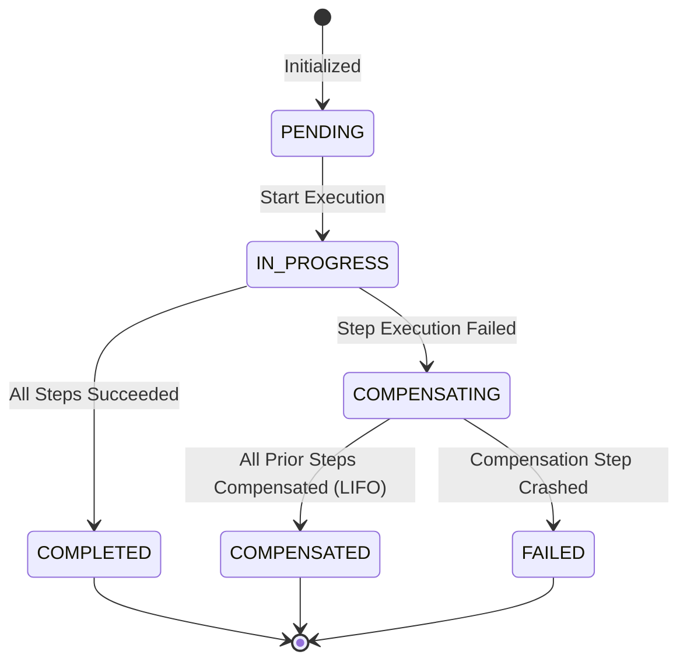

# php-saga

[](https://packagist.org/packages/waqas-badar/php-saga)
[](https://www.php.net/)
[](https://pestphp.com/)
[](https://phpstan.org/)
[](LICENSE)

A lightweight, framework-agnostic implementation of the **Saga Pattern** (orchestrator-driven execution with backward compensation) in modern **PHP 8.2+**. 

Handle complex, distributed, multi-step business transactions without external runtime dependencies (like Temporal, Camunda, or Temporal Server).

---

## ⚡ Highlights

- **Framework-Agnostic & Lightweight**: Zero runtime framework coupling. Runs in vanilla PHP, Laravel, Symfony, or queue workers.
- **Strictly Typed & Modern**: Built for PHP 8.2+ with backed Enums, `readonly` classes, and match expressions.
- **Automatic LIFO Rollback**: When any step fails, previously completed steps are safely compensated in reverse order (Last-In, First-Out).
- **Configurable Retries**: Per-step retry policies with millisecond backoff for transient network glitches.
- **Crash Recovery & Resumption**: Rehydrate interrupted or queued workflows from storage and resume from the exact pending step.
- **PSR-11 & PSR-14 Compliant**: On-demand dependency injection for steps (`class-string`) and native event dispatching for observability.
- **Pluggable Persistence**: Includes high-performance `PdoSagaRepository` (SQLite, MySQL, Postgres) and `InMemorySagaRepository`.

---

## 🔄 Saga Lifecycle State Machine



---

## 📦 Installation

Install via Composer:

```bash
composer require waqas-badar/php-saga
```

---

## 🚀 Quick Start

### 1. Fluent Closure-Based Saga

For quick or inline workflows, define steps with callables and closures:

```php
use PhpSaga\Execution\SagaBuilder;
use PhpSaga\Execution\SagaCoordinator;
use PhpSaga\SagaContext;

$saga = SagaBuilder::new('OrderCheckout')
    ->addCallableStep(
        name: 'ReserveInventory',
        execute: function (SagaContext $ctx) {
            $reservationId = InventoryApi::reserve($ctx->get('product_id'), $ctx->get('qty'));
            $ctx->set('reservation_id', $reservationId);
        },
        compensate: function (SagaContext $ctx) {
            InventoryApi::release($ctx->get('reservation_id'));
        },
        retries: 2
    )
    ->addCallableStep(
        name: 'ChargePayment',
        execute: function (SagaContext $ctx) {
            $chargeId = PaymentGateway::charge($ctx->get('amount'));
            $ctx->set('charge_id', $chargeId);
        },
        compensate: function (SagaContext $ctx) {
            PaymentGateway::refund($ctx->get('charge_id'));
        }
    )
    ->build();

$coordinator = new SagaCoordinator();
$result = $coordinator->run($saga, [
    'product_id' => 'PROD-101',
    'qty' => 1,
    'amount' => 89.99,
]);

if ($result->isSuccessful()) {
    echo "Order completed! Charge: " . $result->getContext()->get('charge_id');
} elseif ($result->isCompensated()) {
    echo "Order failed and was safely refunded: " . $result->getExecutionException()?->getMessage();
}
```

---

### 2. Object-Oriented Class-Based Saga

For structured enterprise codebases, encapsulate steps into dedicated classes and extend `AbstractSaga`:

#### Define Individual Steps
```php
use PhpSaga\Contracts\StepInterface;
use PhpSaga\SagaContext;

class ReserveInventoryStep implements StepInterface
{
    public function getName(): string
    {
        return 'ReserveInventory';
    }

    public function execute(SagaContext $context): void
    {
        // Reserve stock
        $context->set('stock_reserved', true);
    }

    public function compensate(SagaContext $context): void
    {
        // Release stock
        $context->set('stock_reserved', false);
    }
}
```

#### Define the Saga
```php
use PhpSaga\AbstractSaga;
use PhpSaga\Execution\SagaBuilder;

class OrderFulfillmentSaga extends AbstractSaga
{
    public function configure(SagaBuilder $builder): void
    {
        $builder
            ->addStep(ReserveInventoryStep::class, retries: 1)
            ->addStep(ProcessPaymentStep::class)
            ->addStep(DispatchCourierStep::class, continueOnFailure: false);
    }
}
```

#### Execute Through Coordinator
```php
$coordinator = new SagaCoordinator($repository);
$result = $coordinator->run(new OrderFulfillmentSaga(), [
    'customer_id' => 456,
    'order_total' => 129.50,
]);
```

---

## 🛠️ Advanced Capabilities

### 🔁 Crash Recovery & Workflow Resumption

In distributed environments or queue workers (e.g. Laravel Queue / Symfony Messenger), a process might terminate mid-execution. `php-saga` can persist each step's snapshot and resume without repeating work:

```php
$coordinator = new SagaCoordinator($pdoRepository);

// Resumes from the exact step that was pending:
$result = $coordinator->resume('saga-order-uuid-123', new OrderFulfillmentSaga());
```
- Steps already recorded in `completedSteps` are **skipped**.
- If a subsequent step fails, all steps (including those from prior runs) are compensated in proper LIFO order.

---

### 🗄️ Database Storage (PDO Repository)

Persist saga snapshots directly in PostgreSQL, MySQL, or SQLite:

```php
use PhpSaga\Storage\PdoSagaRepository;

$pdo = new PDO('mysql:host=localhost;dbname=myapp', 'root', 'secret');
$repository = new PdoSagaRepository($pdo, tableName: 'sagas');

// Automatically creates the table schema if needed
$repository->createSchema();

$coordinator = new SagaCoordinator(repository: $repository);
```

---

### 📡 Observability & Events (PSR-14)

Attach any PSR-14 event dispatcher to track execution telemetry:

```php
$coordinator = new SagaCoordinator(
    repository: $repository,
    dispatcher: $eventDispatcher
);
```

Dispatched events (under `PhpSaga\Events\`):
- `SagaStarted`
- `StepExecuting` / `StepExecuted` / `StepFailed`
- `CompensationExecuting` / `CompensationExecuted`
- `SagaCompleted` / `SagaCompensated` / `SagaFailed`

---

### 🔌 Framework Integration (e.g. Laravel)

Because `php-saga` adheres to **PSR-11** (Container) and **PSR-14** (Events), registering it in Laravel takes just a few lines in a ServiceProvider:

```php
use Illuminate\Support\ServiceProvider;
use PhpSaga\Execution\ContainerStepResolver;
use PhpSaga\Execution\SagaCoordinator;
use PhpSaga\Storage\PdoSagaRepository;
use Illuminate\Support\Facades\DB;

class SagaServiceProvider extends ServiceProvider
{
    public function register(): void
    {
        $this->app->singleton(SagaCoordinator::class, function ($app) {
            return new SagaCoordinator(
                repository: new PdoSagaRepository(DB::connection()->getPdo()),
                dispatcher: $app['events'],                // Implements PSR-14
                stepResolver: new ContainerStepResolver($app) // Implements PSR-11
            );
        });
    }
}
```

Now any step configured as a class-string (e.g. `addStep(ProcessPaymentStep::class)`) will have its constructor dependencies automatically injected by Laravel!

---

## 🧪 Testing & Quality Gates

Run the test suite via Pest:

```bash
composer test
```

Run PHPStan at maximum level (Level MAX):

```bash
composer stan
```

Run both test and static analysis checks:

```bash
composer check
```

---

## 📄 License

This package is open-source software licensed under the [MIT license](LICENSE).
